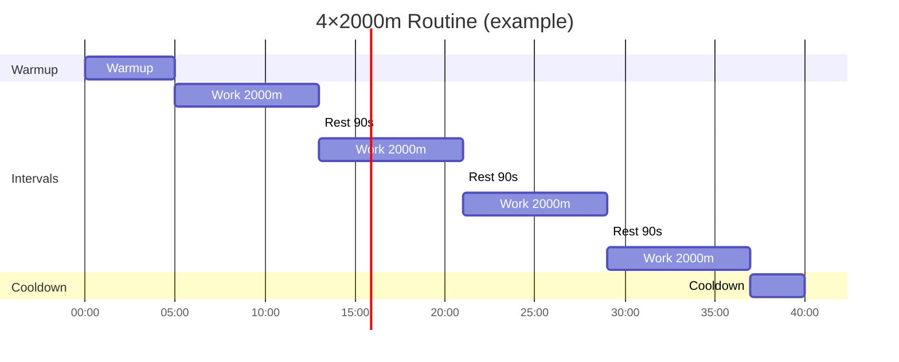

<p align="center">
  
</p>

# RowMate 🚣

**RowMate** is an open-source rowing app built with **Unity 6 LTS + URP**. It connects to your rowing machine over Bluetooth LE (using the **FTMS** standard), runs interval training routines, and puts you in a realistic 3D scene where an animated rower moves at your real speed and stroke rate.

> This repository is the Unity rewrite of [rowmate-legacy](https://github.com/figuibej/rowmate-legacy), the original Flutter app. The goal is **full functional parity** with the legacy app plus a realistic, EXR-style look. The long-term vision is an open-source rowing MMO: a real-time 3D world synchronized with your rowing machine.

Originally built for the **AMS-670B / Kinomap-XG** monitor, but compatible with **any monitor that implements the FTMS standard**.

---

## Migration Status

The migration runs in vertical slices: each iteration ends with something you can try. The full plan is in [docs/migration/ROADMAP.md](docs/migration/ROADMAP.md) and the current state in [docs/migration/STATUS.md](docs/migration/STATUS.md) (both in Spanish).

| Area | Status in Unity |
|------|-----------------|
| Core domain: FTMS and heart rate parsers, data models, formats, es/en text catalog | ✅ Ported (It. 1) |
| App shell, Device screen with live metrics, rower and heart rate **simulator** | ✅ Done (It. 2) |
| Routines: list, editor, series and progressive targets, local database | ✅ Done (It. 3) |
| Workout engine, incremental saving, rest, targets, EXR-style HUD and dialogs | ✅ Done (It. 4a, 4b) |
| Live 500 m splits per series and previous repetitions | ✅ Done (It. 5) |
| 3D scene: sky, time-of-day lighting, alpine lake, water | ✅ Done (It. 6a) |
| Animated rower, boat, oars and stroke cycle | ✅ Done (It. 7) |
| City river, coast and regatta course sceneries, scenery selector | 🚧 Next (It. 8) |
| Session history and detail charts | ⏳ Planned (It. 9) |
| Real Bluetooth on Android and Windows | ⏳ Planned (It. 10a) |
| iOS and macOS | ⏳ Planned (It. 10b, when a Mac is available) |
| Real heart rate sensors | ⏳ Planned (It. 11) |
| Strava upload and sync | ⏳ Planned (It. 12, 13) |
| Advanced water (reflections, wake, fog, glass blur) | ⏸ Postponed ([#6](../../issues/6)) |
| Polish, app identity, platforms and Unity CI | ⏳ Planned (It. 14) |

Until real Bluetooth lands, everything runs against the built-in simulator. If you need to use your rowing machine today, use [rowmate-legacy](https://github.com/figuibej/rowmate-legacy).

---

## Features

The features of the legacy app, all of them in scope for the Unity version (see [Migration Status](#migration-status) for what already works):

- 📡 **BLE scan and auto-reconnect**: connects and recovers from drops automatically
- 📊 **Real-time metrics**: split, SPM, watts, distance, calories, BPM
- ❤️ **Heart rate sensors**: any standard BLE heart rate sensor (chest straps, or a smartwatch with a broadcaster app); remembered and auto-reconnected, avg/max per session (see [Heart Rate Sensors](#heart-rate-sensors))
- 🏋️ **Training routines**: configurable intervals by time or distance, grouped in series
- 🎯 **Targets**: optional watts, SPM and split goals per step, with per-repetition progressions
- 📈 **Session history**: with detailed telemetry and per-step breakdown
- 🔒 **Screen always-on** during workouts
- 🔄 **Strava integration**: upload sessions, sync activities, track sync status
- 🌄 **Immersive workout screen**: a 3D chase-camera scene with water that reflects the sky, an animated rower doing the real stroke sequence (legs → trunk → arms) at your stroke rate, a single scull with real proportions, scenery passing at your real speed, lighting that follows the time of day, and four sceneries (alpine lake, city river, coast, regatta course)
- ⏱️ **500 m splits per series**: live 500 m laps in each work step, meters per repetition, and the last 3 repetitions for comparison (collapsible panels), plus the current time
- 🧪 **Simulator mode**: develop and test without a rowing machine (see [Development without a rower](#development-without-a-rower))
- 🌐 **Spanish and English** UI

---

## Compatible Rowing Machines

RowMate uses the **FTMS (Fitness Machine Service)** protocol, an open Bluetooth SIG standard. If your rowing machine has BLE and supports FTMS, it should work.

| Monitor | Status |
|---------|--------|
| AMS-670B / Kinomap-XG | ✅ Tested |
| Sunny Health & Fitness (SF-RW5623, SF-RW5941, etc.) | ✅ Native FTMS |
| Domyos / Decathlon (R500, R900) | ✅ Native FTMS |
| NordicTrack RW700 / RW900 | ⚠️ Partial |
| WaterRower (with BLE module) | ⚠️ Model dependent |
| Generic BLE rowing machines "FTMS compatible" | ✅ Likely |
| Concept2 (PM5) | ❌ Proprietary protocol |
| Hydrow / Ergatta | ❌ Proprietary protocol |

> This list comes from the legacy app, which has been tested with real hardware. **Tested your rowing machine?** Open an [issue](../../issues) or PR to add it to the list 🙌

---

## Bluetooth Protocol

| Element | UUID |
|---------|------|
| FTMS Service | `0x1826` |
| Rower Data (notifications) | `0x2AD2` |
| Heart Rate Service (sensor) | `0x180D` |
| Heart Rate Measurement (notifications) | `0x2A37` |

Parsed metrics: **Split /500m · SPM · Watts · Distance · Calories · Heart Rate**

Bluetooth uses **native plugins of our own** (Android in Kotlin, iOS/macOS in Swift, Windows in C++/WinRT) behind a single interface in the Core, which always has a simulated implementation too.

---

## Heart Rate Sensors

RowMate connects to **any Bluetooth sensor that implements the standard Heart Rate Profile** (`0x180D`): chest straps (Polar, Garmin, Wahoo, Coospo…), armbands, and smartwatches running a broadcaster app. The device keeps two BLE connections at once: the rower and the sensor.

- **Device tab → heart rate card → Search**, then tap your sensor. The live bpm shows on the card and on the workout screens.
- The sensor is **remembered**: the app reconnects to it automatically on start and after a drop. **Disconnect** also forgets it.
- Heart rate is stored with every session, shown as **avg/max** in the history and session detail, charted in the detail screen, and included in Strava uploads.

> In the Unity version the heart rate card already works with the simulated sensor; real sensors arrive in iteration 11. The notes below come from the legacy app and apply to both.

### Smartwatches (Galaxy Watch, Apple Watch)

Watches don't broadcast heart rate over Bluetooth by default: install a broadcaster app that exposes the standard Heart Rate service.

**Galaxy Watch (Wear OS), tested with a Galaxy Watch 7 and [Heart for Bluetooth](https://play.google.com/store/apps/details?id=lukas.the.coder.heartforbluetooth):**

1. On the watch, grant the app **both** permissions: *Body sensors* **and** *Nearby devices* (Bluetooth). Without *Nearby devices* the app shows your pulse but cannot advertise, so nothing will ever find it.
2. Open the app and start an **Activity**: it shows your heart rate ("accuracy high"). Keep that screen open and the watch screen on while pairing.
3. If the sensor still doesn't show up, go to the app's **Connection** tab and tap **Restart Beacon**.
4. In Galaxy Wearable on the phone, allow the app to run in the background.
5. In RowMate, tap **Search** on the heart rate card. On Windows the watch appears as *Unknown device* with its address (the advertisement carries no name); on Android/iOS it usually shows its name.

To check whether the watch is actually broadcasting, use **nRF Connect** on the phone: *Scanner* tab, filter by Service UUID `180D`. If the list is empty, the watch app isn't advertising and RowMate can't see it either.

---

## Routines & Interval Steps

A **routine** is a sequence of steps. Each step has a type, a duration (by time or distance), and optional performance targets.

| Step Type | Color | Description |
|-----------|-------|-------------|
| Warmup | 🟡 Yellow | Easy opening phase |
| Work | 🔴 Red | Effort interval |
| Rest | 🟢 Green | Recovery |
| Cooldown | 🔵 Blue | Easy closing phase |

Each step is configured **by time** (min:sec) or **by distance** (meters), with optional **watts**, **SPM** and **split** targets that light up during the workout when you fall short.

### Building a Series

You can stack steps to build full training series. A typical interval session looks like this:

```
Warmup (5 min)
  Work (2 min @ 150W+) ─┐
  Rest (1 min)          ├─ repeat × N
  Work (2 min @ 150W+) ─┘
  ...
Cooldown (3 min)
```

Example: a **4×2000m** routine might be:



Each step in the editor can have an individual target, so the app warns you in real time when you drop below your goal.

### Progressive Targets in Series

When configuring a **series** (a group of steps that repeat), you can set **progressive targets** that automatically change with each repetition. This is perfect for ladder workouts and progressive training.

When editing a step **inside a series**, you'll see three optional progression fields:

- **SPM increment (+/rep)**: how much to increase SPM each round (e.g. `+2`)
- **Watts increment (+/rep)**: how much to increase watts each round (e.g. `+5`)
- **Split change (+/-/rep)**: how much to change the split each round, in seconds (e.g. `-2` to go faster)

**Example: progressive SPM ladder**

```
Series configuration:
  - 3 repetitions
  - Work: 5 minutes @ 18 SPM
  - Progression SPM: +2
  - Rest: 2 minutes

Result (auto-expanded):
  1st round: 5 min @ 18 SPM
  2 min rest
  2nd round: 5 min @ 20 SPM
  2 min rest
  3rd round: 5 min @ 22 SPM
```

**Multiple progressions** can be combined in the same step:

```
Work: 8 min @ 150W, 22 SPM
  - Watts progression: +10
  - SPM progression: +2

Result:
  Round 1: 150W @ 22 SPM
  Round 2: 160W @ 24 SPM
  Round 3: 170W @ 26 SPM
```

> **Note:** progression fields only appear when configuring steps inside a series. For standalone steps they're hidden to avoid confusion.

---

## Quick Start

### Requirements

- [Unity Hub](https://unity.com/download) with the **Unity 6000.3.27f1** editor (Unity 6.3 LTS) and the build support modules for your targets (Windows, Android; iOS and macOS later)
- [Git LFS](https://git-lfs.com) (fonts and other binaries are stored with LFS)
- [.NET 8 SDK](https://dotnet.microsoft.com/download/dotnet/8.0), only to run the Core tests outside Unity
- Windows with PowerShell for the helper scripts in `tools/` (the CI also runs them with `pwsh` on Linux)

### Clone and open

```bash
git lfs install
git clone https://github.com/figuibej/rowmate.git
```

Open the folder from Unity Hub with editor 6000.3.27f1. The only scene is `Assets/RowMate/Scenes/Boot.unity`; press **Play** to run the app in the editor.

### Development without a rower

Simulator mode replaces Bluetooth with a simulated FTMS rower and heart rate sensor, so you can work on any platform without hardware.

- **In the editor**: menu **RowMate → Modo simulador** (it stays checked). Unity recompiles with the `ROWMATE_SIMULATOR` define. Uncheck it again before committing.
- **As a Windows build**:

  ```powershell
  powershell -NoProfile -File tools/build/build.ps1 -Target Windows -Simulator
  ```

  The build lands in `Builds/Windows/simulator/RowMate.exe`.

What you get:

- The app starts already connected to "Remo simulado", which sends realistic data every second (split derived from watts with the Concept2 formula, plus distance, strokes and calories).
- The heart rate sensor is simulated too: **Search** on the heart rate card lists a "Pulsómetro simulado" whose bpm follows the simulated effort. Real sensors are not scanned in this mode.
- An orange **SIMULADOR** banner is shown. The 🔧 wrench opens a control panel with:
  - intensity presets (easy, medium, hard);
  - ± watts / SPM;
  - the scene's time of day (or real time);
  - a "Remando" (rowing) switch to stop and resume rowing;
  - a "Simular desconexión" button to test a dropped rower connection;
  - a "Simular caída del pulsómetro" button to test the sensor's auto-reconnect.
- Sessions are saved to a separate database (`rower_app_dev.db`), so test data never mixes with your real history.
- Nothing is ever uploaded to Strava in this mode.

The simulator assemblies only compile with the define, and the build pipeline refuses any non-development build that carries it, so release builds never include the simulator.

### Optional: Mixamo rower

The rower works out of the box with a procedural mannequin. If you want to use Mixamo's free **Y Bot** instead, download it from [Mixamo](https://www.mixamo.com) (*Characters → Y Bot*, *FBX for Unity*, *T-pose*) and save it as `Assets/ThirdParty/Mixamo/YBot/YBot.fbx`. The app picks it up automatically; the stroke itself is procedural IK, so no Mixamo animations are needed. Mixamo files are never committed (their license doesn't allow redistribution). Details in [ASSET_SLOTS.md](docs/migration/design/ASSET_SLOTS.md).

### Builds

```powershell
# Windows (normal, Mono backend)
powershell -NoProfile -File tools/build/build.ps1 -Target Windows

# Android
powershell -NoProfile -File tools/build/build.ps1 -Target Android
```

The script runs Unity in batch mode (close the editor first) and writes to `Builds/<Target>/`. See the header of [tools/build/build.ps1](tools/build/build.ps1) for every option.

### Tests

The pure Core (domain logic, no Unity references) compiles and runs with **.NET 8**, exactly as in the CI:

```powershell
powershell -NoProfile -File tools/dotnet/run-tests.ps1
```

The same test sources also run inside Unity (EditMode and PlayMode), in batch mode with the editor closed:

```powershell
powershell -NoProfile -File tools/unity/run-unity-tests.ps1 -Simulator
powershell -NoProfile -File tools/unity/run-unity-tests.ps1 -Platform PlayMode -Simulator
```

More options in [tools/dotnet/README.md](tools/dotnet/README.md) and [tools/unity/README.md](tools/unity/README.md). Every push runs the Core tests on Ubuntu and Windows ([ci-core.yml](.github/workflows/ci-core.yml)).

---

## Project Structure

```
Assets/RowMate/
├── Core/                 # Pure C# (no Unity): models, FTMS and heart rate parsers, workout engine,
│                         #   series, scene math, stroke kinematics, design tokens, localization
├── App/                  # Pure C#: per-screen stores and app composition
├── Infrastructure/       # SQLite, preferences, (Strava clients)
├── Platform/             # Platform adapters: BLE, wakelock, permissions, system locale, graphics tier
├── Simulator/            # Simulated rower and heart rate sensor (only with ROWMATE_SIMULATOR)
├── SimulatorPresentation/# Simulator control panel UI
├── Presentation/         # UI Toolkit screens, controls, styles (UXML/USS) and motion
├── Scene/                # 3D scene: director, camera, water, sky, boat, rower, shores, VFX, asset slots
├── Bootstrap/            # Composition root (AppRoot)
├── Editor/               # Editor tooling: bootstrapper, simulator mode, build CLI, slot validators
├── Art/                  # Shaders and materials
├── UI/                   # Fonts (OFL) and icons (Apache 2.0)
├── Slots/                # Asset slots: every 3D asset has a procedural fallback
├── Localization/         # strings.es.json, strings.en.json
├── Scenes/               # Boot.unity (the only scene) and scenery definitions
├── Settings/             # URP and quality tiers (High, Medium, Low)
└── Tests/                # EditMode (shared with .NET 8), Simulator, PlayMode, golden vectors
tools/
├── dotnet/               # .NET 8 solution that mirrors the pure assemblies and runs their tests
├── unity/                # Unity test runner and snapshot capture scripts
├── build/                # Command-line builds
├── oracle/               # Dart oracle that generates golden vectors from the legacy code
├── tokens/               # Generates Tokens.uss from Core/Design/Tokens.cs
└── l10n/, fonts/         # Text catalog and font tooling
docs/migration/           # Product inventory, architecture, art and animation bibles, per-iteration specs and reports
```

The architecture is described in [docs/migration/architecture/ARCHITECTURE.md](docs/migration/architecture/ARCHITECTURE.md) (in Spanish).

---

## Strava Integration (optional)

> Coming in iterations 12 and 13. Setup instructions will be added here when it lands.

RowMate can upload your rowing sessions to Strava and sync activities from other devices. **Strava is completely optional**: the app works fully offline without it, and Strava doesn't show up at all when the build has no credentials. Credentials are injected at build time and are never committed.

- **Upload to Strava**: bulk-upload all unsynced local sessions with one tap
- **Auto-upload**: sessions upload to Strava automatically after finishing (configurable)
- **Ask each time**: shows a dialog after each workout
- **Manual upload**: upload individual sessions from the session detail screen
- **Sync from Strava**: download your rowing activities from Strava to the local history
- **Sync status**: each session in history shows a Strava icon indicating sync status
- **Session auto-repair**: sessions that didn't save properly (e.g. app closed mid-workout) are repaired from telemetry data before uploading
- **Duplicate detection**: re-uploading an already synced session links to the existing Strava activity instead of creating a duplicate

---

## Platform Notes

| Platform | Status |
|----------|--------|
| Windows 10 21H1+ | Editor and builds (Mono backend; IL2CPP pending). Bluetooth through a native C++/WinRT plugin (It. 10a) |
| Android 8.0+ (ARM64) | Builds supported; performance target is 60 fps on a mid-range phone. Native Kotlin BLE plugin (It. 10a) |
| iOS / macOS | Native Swift plugin planned for iteration 10b. Bluetooth on iOS needs a physical device |

---

## How This Project Is Built

The migration follows a fixed cycle per iteration, run with Claude Code agents defined in [.claude/agents/](.claude/agents/): the product owner writes the spec, the architect designs and implements it, QA checks that both agree and then verifies the result against the acceptance criteria and the legacy behavior, and the designer owns art, UI and animation. Each iteration leaves its spec, design, QA reports and snapshots under [docs/migration/iterations/](docs/migration/iterations/). The legacy app is the behavior contract: its tests are ported, and a Dart oracle generates golden vectors so numbers match exactly.

---

## Contributing

Contributions are welcome! If you have a compatible rowing machine not on the list, or want to add metrics or features, open an [issue](../../issues) or a PR. Most of the project documentation is in Spanish; issues and PRs in English or Spanish are both fine.

---

## License

[MIT](./LICENSE) © 2026 Fernando Iguibejeres. Third-party code included in the app is listed in [THIRD_PARTY_NOTICES.md](./THIRD_PARTY_NOTICES.md).
